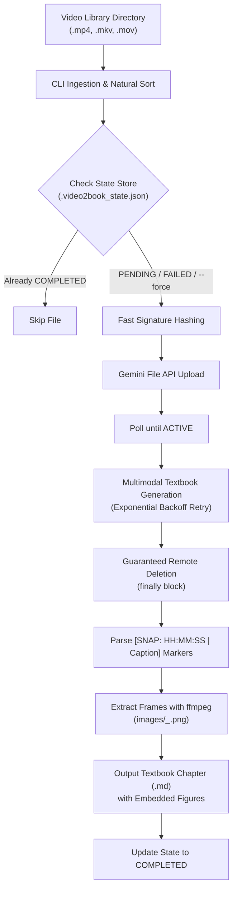

# `video2book`

> **Production-grade CLI pipeline converting massive video lecture libraries (170+ hours of MP4s) into comprehensive, unabridged technical textbook chapters in Markdown, complete with extracted diagrams and visual screenshot figures.**

---

## 🌟 Key Highlights

- **Modern SDK**: Powered by the official Google GenAI SDK (`google-genai`, `from google import genai`), strictly avoiding legacy packages.
- **Resumable State Machine**: Automatic checkpointing via atomic JSON state tracking (`.video2book_state.json`). If a multi-day run stops or crashes, restarting automatically skips completed files.
- **Fast Fingerprinting**: Instant (<5ms) collision-resistant chunk-based signature hashing that avoids thrashing disk I/O on 100GB+ archives.
- **Guaranteed Remote Cleanup**: Files uploaded to Gemini File API are deleted in guaranteed `finally` blocks, preventing cloud storage clutter.
- **Exponential Backoff**: Robust handling of HTTP 429 rate limits, 503 service drops, and socket timeouts using `tenacity` with jitter.
- **Frame-Accurate Snapshot Extraction**: LLM inserts precise temporal markers `[SNAP: HH:MM:SS | Caption]`, which are extracted via system `ffmpeg` into high-resolution PNGs and linked in standard Markdown.
- **Obsidian Ready**: Generates standard Markdown compatible with Obsidian, complete with relative image references, LaTeX math (`$...$`), and callout admonitions (`> [!NOTE]`).

---

## 🏗 Architecture & Workflow



---

## 📦 Project Layout

```
videoToTextScript/
├── video2book/
│   ├── __init__.py         # Package entrypoint & version
│   ├── __main__.py         # Entrypoint for python -m video2book
│   ├── cli.py              # CLI arguments, Rich progress bars, and execution loop
│   ├── gemini.py           # File API upload, polling, generation, cleanup, retry logic
│   ├── extractor.py        # Regex parsing for [SNAP: ...] and ffmpeg frame grabbing
│   ├── state.py            # Checkpointing (tracks PENDING, COMPLETED, FAILED)
│   ├── gui/                # Desktop GUI Studio (CustomTkinter & Pillow)
│   │   ├── __init__.py     # GUI launch_gui & main entry points
│   │   ├── __main__.py     # python -m video2book.gui entrypoint
│   │   ├── app.py          # Main Video2BookApp window & sidebar navigation
│   │   ├── config.py       # Persistent user preferences & config storage
│   │   ├── worker.py       # Background pipeline worker thread & event queue
│   │   └── views/          # Modular studio views
│   │       ├── queue_view.py    # Queue list, filters, batch runner & live logs
│   │       ├── viewer_view.py   # Markdown textbook reader & figures gallery
│   │       ├── stats_view.py    # Analytics dashboard & state inspection
│   │       └── settings_view.py # API key, model selector, prompt customization
│   └── requirements.txt    # Module dependencies
├── tests/
│   ├── test_cli.py
│   ├── test_extractor.py
│   ├── test_gemini.py
│   ├── test_state.py
│   ├── test_ffmpeg_integration.py
│   ├── test_gui_config.py
│   ├── test_gui_worker.py
│   └── test_gui_components.py
├── pyproject.toml          # PEP 517 / 621 build configuration
├── requirements.txt        # Root requirements
└── README.md               # Pipeline documentation
```

---

## ⚙️ Prerequisites

1. **Python 3.10+**
2. **System `ffmpeg`**:
   `video2book` verifies `ffmpeg` on startup. If not installed:
   - **Windows**: `winget install Gyan.FFmpeg` or `choco install ffmpeg`
   - **macOS**: `brew install ffmpeg`
   - **Linux (Ubuntu/Debian)**: `sudo apt update && sudo apt install ffmpeg`
3. **OpenRouter API Key**:
   Get an API key from [OpenRouter](https://openrouter.ai/keys). You can browse all available Gemini models at [openrouter.ai/models](https://openrouter.ai/models).

---

## 🚀 Installation

### 1. Set Up Virtual Environment

```bash
# Clone or navigate to the repository directory
cd videoToTextScript

# Create virtual environment
python -m venv .venv

# Activate virtual environment
# Windows (PowerShell):
.\.venv\Scripts\Activate.ps1
# Windows (CMD):
.\.venv\Scripts\activate.bat
# Linux / macOS:
source .venv/bin/activate
```

### 2. Install Dependencies & CLI

```bash
# Install package in editable development mode
pip install -e .
```

---

## 🔑 Environment Variable Setup

Set your `OPENROUTER_API_KEY`:

### Windows (PowerShell):
```powershell
$env:OPENROUTER_API_KEY="sk-or-v1-YourSecretOpenRouterAPIKeyHere"
```

### Windows (CMD):
```cmd
set OPENROUTER_API_KEY=sk-or-v1-YourSecretOpenRouterAPIKeyHere
```

### Linux / macOS (Bash / Zsh):
```bash
export OPENROUTER_API_KEY="sk-or-v1-YourSecretOpenRouterAPIKeyHere"
```

You can also pass it explicitly via the `--api-key` flag or configure it in the Desktop GUI Settings tab.

---

## 🔍 Exploring Available Gemini Models

To fetch and inspect all currently active Google Gemini models on OpenRouter with their video support and context lengths directly from `https://openrouter.ai/models`:

```bash
video2book --list-models
```

---

## 🖥️ Desktop GUI Studio

`video2book` includes a modern, dark-mode Desktop GUI Studio built with `CustomTkinter` and `Pillow`.

### Launching the Desktop GUI

Run any of the following commands from your terminal:

```bash
# Dedicated GUI command
video2book-gui

# Via CLI flag
video2book --gui

# Via Python module
python -m video2book.gui
```

### ✨ Desktop GUI Key Features:

- **📋 Interactive Queue & Batch Runner**:
  - Folder scanner and individual file selector.
  - Real-time progress bars: overall batch completion and per-file step status (uploading, remote processing, generating, snapshot extraction).
  - Search filter and status tabs (`All`, `Pending`, `Completed`, `Failed`).
  - One-click run for the whole library or single-file processing.
  - Live colored execution log console with copy/clear buttons.

- **📖 Textbook Chapter Viewer & Figures Gallery**:
  - Built-in Markdown reader for inspecting generated textbook chapters.
  - Quick action buttons: *Open in Obsidian / Default Editor*, *Reveal in Explorer*, and *Copy Markdown*.
  - Visual Figure Snapshot gallery displaying thumbnail cards of all extracted diagrams with timestamp badges and captions. Click to open in full resolution.

- **📊 Analytics & State Checkpointing**:
  - Dashboard metric cards: completed chapters, total extracted diagram figures, failed items, and processing duration.
  - Direct inspection of `.video2book_state.json` checkpoint records.
  - Instant *Reset Failed to PENDING* button for resuming failed runs.

- **⚙️ Settings & System Health**:
  - Gemini API Key configuration with show/hide toggle and a live **Test API Connection** diagnostic button.
  - Model selector (`gemini-2.5-flash`, `gemini-2.5-pro`, `gemini-2.0-flash`, `gemini-1.5-pro`).
  - Full customization of pedagogical system instructions and prompts.
  - Automatic system `ffmpeg` verification badge.
  - Dark, Light, and System appearance theme switcher.

---

## 💻 CLI Usage & Examples

### 1. Dry Run Audit (No Uploads or Changes)
Test and validate your files, API connectivity, and state without making any network calls:
```bash
video2book -i "D:\Lectures\DistributedSystems" -o "./textbook" --dry-run
```

### 2. Standard Production Run
Convert an entire video library into textbook chapters:
```bash
video2book -i "D:\Lectures\DistributedSystems" -o "./textbook"
```

### 3. Using a Custom Gemini Model
By default, `video2book` uses `gemini-2.5-flash`. You can specify any supported model:
```bash
video2book -i "D:\Lectures" -o "./textbook" --model "gemini-2.5-pro"
```

### 4. Resuming an Interrupted Run
If a 170-hour batch run is interrupted by network blips or power loss, simply re-run the same command:
```bash
video2book -i "D:\Lectures\DistributedSystems" -o "./textbook"
```
Files marked as `COMPLETED` whose Markdown chapter exists on disk are **automatically skipped**.

### 5. Retrying Failed Files
Reset previously failed entries back to `PENDING` before executing:
```bash
video2book -i "D:\Lectures" -o "./textbook" --reset-failed
```

### 6. Forcing Reprocessing
Reprocess all files regardless of completed status:
```bash
video2book -i "D:\Lectures" -o "./textbook" --force
```

### 7. Custom File Extensions & Polling Interval
```bash
video2book -i "D:\Lectures" -o "./textbook" --extensions "mp4,mkv,mov,webm" --poll-interval 3.0
```

---

## 📊 CLI Options Reference

| Flag | Short | Default | Description |
|------|-------|---------|-------------|
| `--input-dir` | `-i` | *(Required)* | Source directory containing video files (scanned recursively). |
| `--output-dir` | `-o` | `./output` | Destination directory for `.md` chapters and `images/`. |
| `--model` | `-m` | `gemini-2.5-flash` | Gemini model to use for generation. |
| `--dry-run` | | `False` | Validate files and state without uploading or extracting frames. |
| `--force` | `-f` | `False` | Force reprocessing of files even if marked `COMPLETED`. |
| `--api-key` | | `$GEMINI_API_KEY` | Gemini API Key. |
| `--state-file` | | `<output-dir>/.video2book_state.json` | Custom path to the state tracking JSON store. |
| `--reset-failed` | | `False` | Reset `FAILED` jobs to `PENDING` before starting. |
| `--poll-interval` | | `5.0` | Seconds between polling Gemini File API for `ACTIVE` state. |
| `--extensions` | | `mp4,mkv,mov,webm,avi` | Comma-delimited video extensions. |
| `--verbose` | `-v` | `False` | Enable debug logs and detailed stack traces. |

---

## 📓 Markdown Output Structure & Obsidian Integration

The generated output is structured as follows:

```
textbook/
├── .video2book_state.json
├── images/
│   ├── lecture_01_00h04m12s.png
│   ├── lecture_01_00h18m45s.png
│   └── lecture_02_00h11m03s.png
├── Lecture 01 - Distributed Architecture.md
└── Lecture 02 - Consensus Protocols.md
```

### How Figures Are Embedded

In the generated Markdown chapter:

```markdown
# Chapter: Distributed Systems Architecture

## 1. Consensus Protocols & Leader Election

The consensus protocol maintains consistency across node failure domains. Below is the transition state machine:


*Figure: Raft Consensus State Machine (Timestamp: 00:04:12)*

### Leader Election Algorithm
...
```

### Opening in Obsidian

1. Open **Obsidian**.
2. Click **Open folder as vault** and select your `--output-dir` (e.g. `F:\textbook`).
3. Under **Settings > Files and links**:
   - Set **Default location for new attachments** to `In subfolder under current folder` with subfolder name `images`.
   - Set **Use [[Wikilinks]]** according to preference (the pipeline uses standard relative markdown links `images/...` which Obsidian displays natively).
4. Diagrams, math formulas ($LaTeX$), code snippets, and callouts will render seamlessly!

---

## 🛡️ Production Resiliency Features

1. **Atomic State Checkpointing**: State writes use `tempfile.NamedTemporaryFile` + `os.replace` to prevent corrupted JSON files even during sudden termination.
2. **Guaranteed Cloud Cleanup**: File uploads are registered in `try...finally` blocks so `client.files.delete(name=uploaded.name)` executes unconditionally upon success or failure.
3. **Exponential Backoff**: Wrapped with `tenacity` retrying on HTTP 429 (ResourceExhausted), HTTP 500, 502, 503, 504, and socket dropouts with randomized jitter.
4. **Natural File Sorting**: Discovered lecture videos are sorted naturally (`Lecture 1`, `Lecture 2`, ..., `Lecture 10`, `Lecture 20`) so textbook chapters follow the exact syllabus order.

---

## 🧪 Running Unit & Integration Tests

The test suite validates state transitions, regex parsing, timestamp normalizations, mock Gemini ingestion, and real ffmpeg execution:

```bash
# Run all tests
pytest -v

# Run specific suite
pytest -v tests/test_state.py
pytest -v tests/test_extractor.py
pytest -v tests/test_gemini.py
pytest -v tests/test_cli.py
pytest -v tests/test_ffmpeg_integration.py
```
